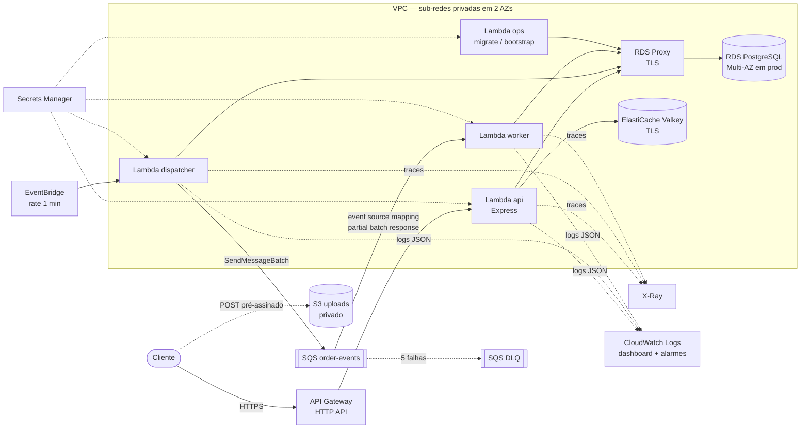
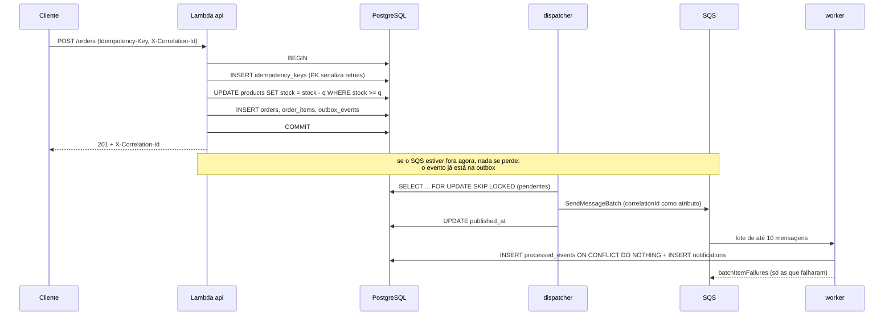

# Arquitetura

## Visão geral na AWS

Saída das sub-redes privadas para APIs AWS (SQS, Secrets Manager, X-Ray):
NAT Gateway. S3: endpoint de gateway (gratuito). Detalhe em
[decisions.md](decisions.md#nat-gateway-em-vez-de-endpoints-de-interface).

## Fluxo de um pedido

### Garantias e onde elas moram

| Garantia | Mecanismo | Teste |
|---|---|---|
| Estoque nunca negativo | `UPDATE ... WHERE stock >= q` sob row lock + `CHECK (stock >= 0)` | `orders.test.js` — 4 compradores, 1 unidade |
| Sem deadlock entre pedidos | locks sempre na ordem de `product_id` | (por construção) |
| Idempotência | PK `(user_id, key)` + hash canônico do payload | `orders.test.js` — retries concorrentes, payload diferente → 409 |
| Evento não se perde entre commit e fila | transactional outbox | `jobs.test.js` — SQS fora, depois volta |
| Sem publicação dupla por dispatchers concorrentes | `FOR UPDATE SKIP LOCKED` | `jobs.test.js` |
| Reentrega não duplica efeito | `processed_events` + efeito na mesma transação | `jobs.test.js` |
| Mensagem ruim não trava o lote | partial batch response → DLQ após 5 tentativas | `jobs.test.js` + `ReportBatchItemFailures` no Terraform |
| Pedido alheio invisível | filtro `user_id` na query; 404 igual a inexistente | `orders.test.js` |
| Catálogo sobrevive ao Redis | cache-aside que trata erro como miss, timeouts curtos | `products.test.js` — Redis numa porta morta |

## Observabilidade e o "sidecar"

O rascunho original pedia um *sidecar pattern*. Sidecar é um container ao
lado do container da aplicação, no mesmo pod/task. **Lambda não tem
containers lado a lado**, então o projeto aplica o padrão onde ele existe e
usa o equivalente da plataforma onde não existe:

| Onde | O que faz o papel do sidecar |
|---|---|
| Local (`docker compose`) | container `otel-collector` ao lado do `api`. A aplicação só conhece `OTEL_EXPORTER_OTLP_ENDPOINT`; batching, destino e credenciais ficam no collector. É um sidecar de verdade. |
| Lambda | **Lambda Extension** — um processo que roda no mesmo ambiente de execução da função, com ciclo de vida próprio. A layer ADOT/OpenTelemetry é exatamente isso. Opcional aqui (`adot_layer_arn`); sem ela, o X-Ray *active tracing* nativo registra cada invocação. |

Em ambos os casos os logs são JSON (pino) com `timestamp`, `level`,
`correlationId`, `traceId`, `route`, `status` e `durationMs`, e campos
sensíveis (`password`, `token`, `authorization`, `email`, `secret`) são
redigidos na origem.

O `correlationId` atravessa o sistema: header HTTP → coluna
`outbox_events.correlation_id` → atributo da mensagem SQS → contexto do
worker. Uma consulta salva no Logs Insights
(`monitoring/queries/trace-correlation-id.query`) junta as três pontas.
